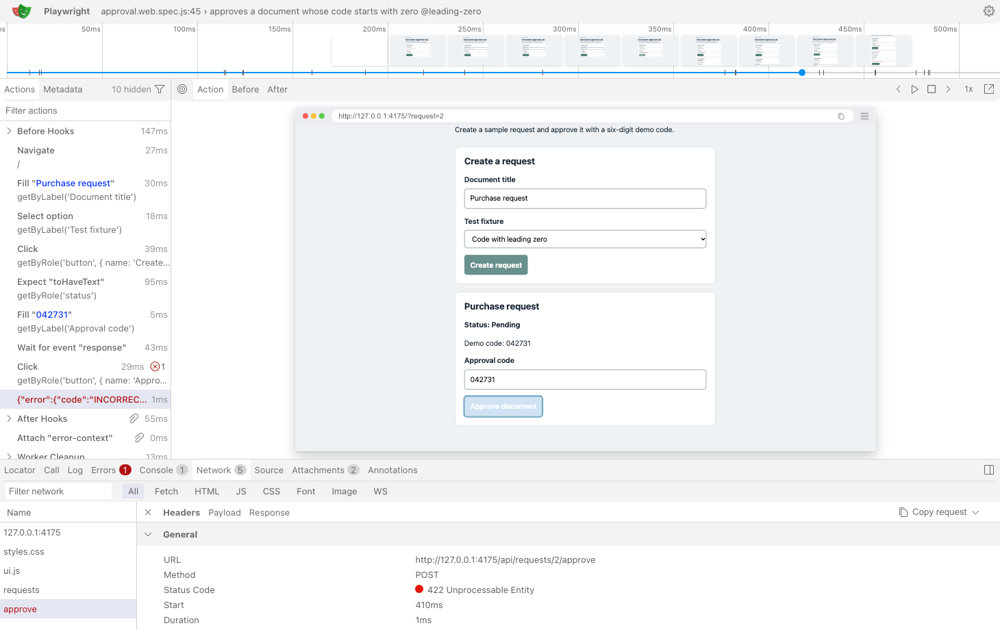

# Document Approval QA Lab

Proyek portofolio QA untuk alur persetujuan dokumen dengan kode enam digit.
Dokumen dan kode berasal dari fixture sintetis.

## Studi kasus kode 042731

1. **Risiko.** Kode yang valid harus bisa menyetujui permintaan. Kode yang salah harus membiarkan status tetap `pending`.
2. **Bug.** Pada mode legacy, `042731` ditolak dengan `422 INCORRECT_CODE` dan permintaan tetap `pending`.
3. **Bukti.** Trace browser memperlihatkan bahwa UI mengirim kode sebagai teks dan menerima `422`. Tes API langsung menghasilkan respons yang sama sehingga masalah bisa dilokalisasi ke server.
4. **Perbaikan.** Server membandingkan kode sebagai teks enam digit agar nol di depan tetap dipertahankan.
5. **Regresi.** Jalankan `npm test` untuk memeriksa kode valid dan tidak valid, status setelah reload, persetujuan ulang, sinkronisasi status di dua tab, serta judul panjang di layar sempit. `npm run test:bug` menjalankan dua tes reproduksi yang sengaja gagal di mode legacy.



Lihat [laporan BUG-001](docs/BUG-001.md) dan [rencana pengujian](docs/TEST-PLAN.md) untuk langkah reproduksi dan hasil yang diharapkan.

## Menjalankan proyek

Siapkan Node.js 24 atau lebih baru. Jalankan perintah berikut dari folder proyek.

```sh
npm ci
npx playwright install chromium
npm start
```

Buka [aplikasi lokal](http://127.0.0.1:4173/). Isi judul, pilih **Standard code**
(`123456`) atau **Code with leading zero** (`042731`), lalu buat dan setujui
permintaan. Aplikasi menyimpan data demo di `var/approval.sqlite`.

### Pengujian manual dan Postman

Ikuti [matriks pengujian](docs/TEST-PLAN.md) dan
[kontrak API](docs/API.md). Saat aplikasi berjalan, impor
[koleksi Postman](postman/Document-Approval-QA.postman_collection.json).
Jalankan koleksi dari awal sampai akhir di **Collection Runner**. Variabel
`baseUrl` sudah menunjuk ke aplikasi lokal. Setiap run membuat dua record baru
dan menggunakan ID dari respons create.

Untuk melihat data yang tersimpan di SQLite, jalankan kueri berikut dari folder
proyek. Cocokkan ID dengan respons `POST /api/requests`.

```sh
sqlite3 -header -column var/approval.sqlite \
  'SELECT id, fixture, status, approved_at FROM approval_requests ORDER BY id;'
```

### Playwright dan investigasi bug

```sh
npm test
npm run report
```

Playwright menyalakan server sendiri dan memakai database sementara di memori.
Jalankan skenario regresi pada versi yang sengaja bermasalah dengan perintah
berikut. Dua tes diharapkan gagal dengan HTTP `422` saat mengharapkan `200`.

```sh
npm run test:bug
npm run report -- playwright-report-legacy
```

Buka **Trace** pada tes browser yang gagal dan ikuti langkah investigasi di
[laporan BUG-001](docs/BUG-001.md). Untuk mereproduksi secara manual, hentikan
server manual yang sedang berjalan dan jalankan
`APPROVAL_LEGACY_BUG=1 npm start` (macOS/Linux). Buat permintaan baru sebelum
membandingkan kedua mode.

## GitHub Actions

[Workflow QA](.github/workflows/qa.yml) menjalankan tes API dan browser pada
push, pull request, atau pemicu manual. Unduh artefak `playwright-report`
dari halaman run untuk memeriksa hasil tes. Untuk kegagalan browser, laporan
menyertakan trace. Mode bug dijalankan terpisah dari workflow regresi normal.

## Referensi

- [Playwright di GitHub Actions](https://playwright.dev/docs/ci)
- [Postman Collection Runner](https://learning.postman.com/docs/tests-and-scripts/running-collections/intro-to-collection-runs)
